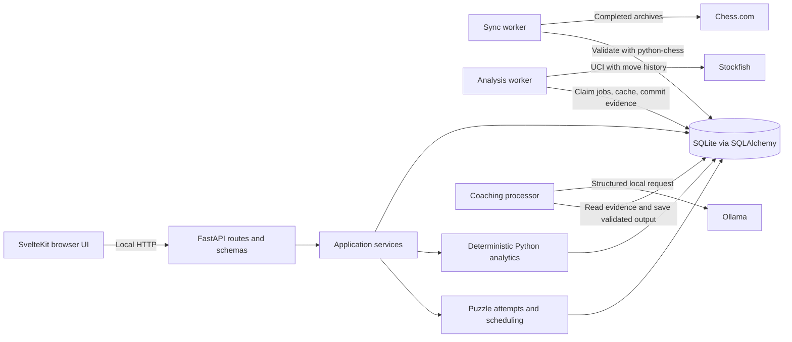
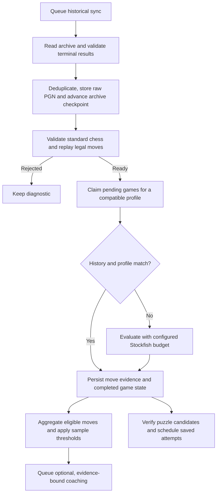

# Architecture

Chess Coach processes completed games on one machine. The browser uses the
FastAPI contract for all app data. SQLite holds both the game library and the
state needed to resume background jobs.

API routes handle transport and serialize explicit schemas. The application
layer coordinates use cases and owns the dependency boundaries. Repositories
own database access and durable job admission. Alembic creates and updates the
schema. The packaged launcher serves the built UI on the same loopback origin
as the API. Development uses a Vite proxy to the same API paths.

## Incremental processing

The cache includes the start position, ordered move history, engine version,
analysis version, budget/configuration and draw policy. Mate scores stay separate
from centipawns. Analysis commits evidence before marking a game complete.
Ollama interprets structured evidence. The API renders authoritative moves,
scores and counts from persisted deterministic data.

## Failure boundaries

| Dependency | User-visible impact | Saved work |
| --- | --- | --- |
| Chess.com | New sync can fail or rate-limit. Committed archive checkpoints survive. | Stored games can still be analyzed and reviewed. |
| Stockfish or analysis worker | New analysis requires a compatible worker and responding engine. | Completed evidence, compatible cached reports and existing puzzles remain readable. |
| Ollama or configured model | Uncached explanations cannot be generated. | Analytics and compatible cached explanations remain available. |
| SQLite or required schema | Readiness returns 503 when the API is listening. Packaged startup checks core dependencies before listening. | Data features need the correct readable database and migrated schema. |
| Browser or Vite | The UI reports a lost backend connection where applicable. | Worker jobs can continue independently of the browser. |

See the [HTTP contract](api-contract.md), [operations guide](operations.md) and
[decision records](adr/README.md) for contracts, recovery and tradeoffs.
